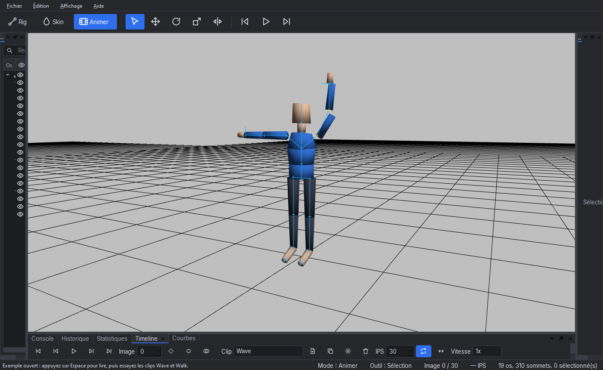
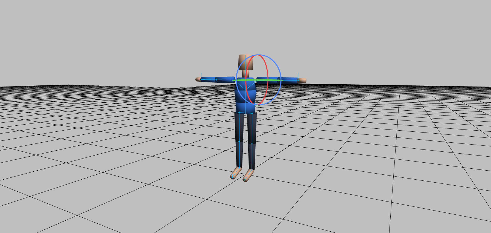
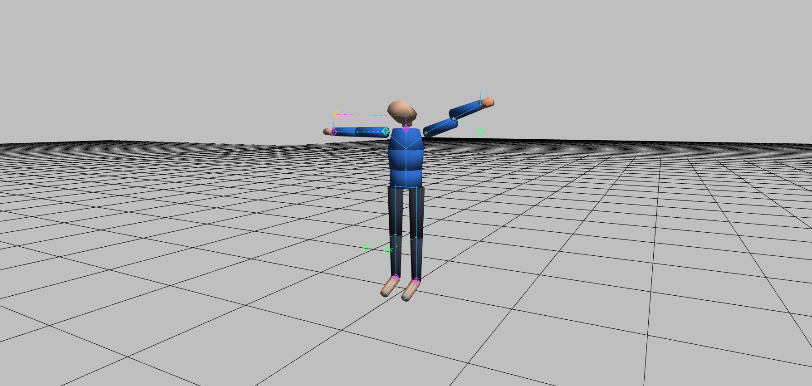

# Rigger3D — Guide de prise en main (10 minutes)

Ce guide vous mène de l'ouverture du logiciel à l'export d'une animation : **importer → peindre → poser → animer → exporter**.
Les captures proviennent de la version 1.0.0.

## 0. Premier lancement (1 min)

Au démarrage, l'écran d'accueil propose :

- **Nouvelle scène** : scène vide ;
- **Importer un modèle…** : un personnage glTF / GLB ;
- **Ouvrir l'exemple** : *Rigby*, un personnage prêt à l'emploi avec deux animations (*Wave* et *Walk*), libre de droits (CC0) ;
- **Tutoriel de démarrage rapide** : rappel en cinq points.

Cliquez sur **Ouvrir l'exemple**, puis appuyez sur `Espace` : le personnage salue. Rien n'est écrasé : l'exemple se
« Enregistre sous… » toujours sous un nouveau nom.

Navigation dans la vue 3D : `Alt` + glisser gauche = orbiter, `Alt` + glisser milieu = déplacer, molette = zoom,
`F` = cadrer la sélection.

## 1. Importer un modèle (1 min)

`Fichier > Importer…` (`Ctrl+I`) ou glissez un fichier `.gltf` / `.glb` sur la fenêtre. Le personnage s'affiche skinné ;
si le fichier contient des animations, elles apparaissent dans la timeline. En ligne de commande : `rigger modèle.glb`.

Les extensions de compression (Draco, Meshopt, Basis) ne sont pas gérées : le message d'erreur l'indique.

## 2. Peindre les poids (2 min)

Passez en mode **Skin** (touche `2`). La vue colore chaque sommet selon l'influence de l'os choisi (bleu = 0, rouge = 1).

1. Sélectionnez un os dans la **Hiérarchie**.
2. Dans le panneau **Skin**, activez **Paint**, choisissez le mode (*Add*, *Subtract*, *Replace*, *Smooth*), le rayon, la force
   et le falloff. `[` et `]` règlent le rayon. Chaque coup de pinceau est une entrée de l'historique (`Ctrl+Z`).
3. Les poids d'un sommet font toujours 1 au total, avec 4 influences au plus. Verrouillez un os pour le protéger.
4. **Auto skin** donne un bon point de départ ; la méthode *Heat diffusion* suit la topologie du maillage (plus lisse,
   plus lente) et *Distance* est instantanée.
5. **Select Vertices** sélectionne au clic, au **rectangle** ou au **lasso**, puis on saisit un poids exact ou on applique
   *Normalize*, *Limit to 4 influences*, *Prune* ou *Copy weights*.

## 3. Poser le squelette (2 min)

Mode **Rig** (`1`) pour éditer la structure, mode **Animate** (`3`) pour poser.

- `Q` sélection · `W` déplacer · `E` tourner · `R` étirer. Le gizmo suit l'os sélectionné.
- L'**Inspecteur** donne les valeurs exactes (glissez un nombre pour l'ajuster, double-cliquez pour saisir).
- **Symétrie** : l'outil miroir applique le geste à l'os jumeau (`.L` / `.R`).
- **Cinématique inverse** : panneau **IK**, **Humanoid Preset**. Des cibles apparaissent aux mains et aux pieds ;
  déplacez-les et la chaîne suit. `I` bascule entre IK et FK. Les pôles contrôlent la direction des coudes et des genoux.

## 4. Animer (3 min)

1. En mode Animate, choisissez un clip (ou créez-en un avec le bouton *New clip* de la **Timeline**).
2. Placez-vous sur une image, posez le personnage, puis `K` insère une clé. `Ctrl+K` active la **clé auto** : chaque
   modification crée la clé.
3. Dans la timeline : clic / rectangle = sélectionner, glisser = déplacer, `Alt`+glisser = dupliquer, `Ctrl`+glisser =
   étirer, `Maj`+glisser = décaler toutes les clés, molette = zoom.
4. L'onglet **Courbes** édite l'interpolation (constante, linéaire, Bézier) clé par clé.
5. `Maj+O` affiche la **pelure d'oignon** (images voisines en transparence).
6. Le panneau **Mix** superpose plusieurs clips (couches, masques, fondus enchaînés, additif) et **rétro-cible** une
   animation vers un autre squelette.
7. Le panneau **Deform** gère blend shapes, twist, contraintes, spring bones et l'onglet **Auto-Rig** (*Generate Humanoid Rig* : squelette et skinning en quelques clics).
8. La bibliothèque de **poses** mémorise des poses réutilisables.

`Espace` lit / met en pause ; `←` `→` avancent d'une image.

## 5. Enregistrer et exporter (1 min)

- `Ctrl+S` enregistre le projet (`.rig`, JSON) : os, poids, clips, IK, mix, caméra. L'écriture est atomique et une
  **sauvegarde automatique** permet de récupérer le travail après un plantage.
- `Ctrl+Maj+E` exporte en **glTF / GLB** (maillage, squelette, skinning, animations, blend shapes). Les options permettent
  de *baker* l'IK et les déformations en clés d'os pour que n'importe quel moteur les lise.
- *Exporter une séquence d'images* produit des PNG transparents.

Export en ligne de commande : `rigger modèle.glb --export-gltf sortie.glb`.

## Aide-mémoire des raccourcis

| Touche | Action | Touche | Action |
|---|---|---|---|
| `1` `2` `3` | Rig / Skin / Animate | `Espace` | Lecture / pause |
| `Q` `W` `E` `R` | Sélection / déplacer / tourner / étirer | `←` `→` | Image précédente / suivante |
| `K` | Insérer une clé | `Maj+←` `Maj+→` | Première / dernière image |
| `Ctrl+K` | Clé auto | `Maj+O` | Pelure d'oignon |
| `Ctrl+O` `Ctrl+S` | Ouvrir / enregistrer | `Ctrl+Maj+S` `Ctrl+Maj+E` | Enregistrer sous / exporter glTF |
| `I` | Bascule IK / FK | `Ctrl+Z` `Ctrl+Y` | Annuler / rétablir |
| `F` | Cadrer la sélection | `Suppr` | Supprimer |

Tous les raccourcis sont modifiables dans `Édition > Préférences`. L'interface existe en français et en anglais
(changement à chaud), avec thème sombre ou clair.

## Licence

Rigger3D est un logiciel libre, © 2026 Patrick JAILLET, distribué sous licence **GPL-3.0-or-later**. `Aide > À propos`
affiche le copyright, la licence, l'e-mail de contact (sandefjord.development@proton.me), le site
(https://patrickjaillet.github.io/Rigger3D) et la liste des licences tierces.

## En cas de problème

- **Le rendu ne démarre pas** : Rigger exige OpenGL 4.1 core ; `Aide > À propos` indique la version détectée.
- **Plantage** : un rapport est enregistré **uniquement sur votre ordinateur** (dossier de journaux, fichier `.txt` et
  minidump sous Windows) et signalé au prochain lancement. Rien n'est envoyé : Rigger n'a ni télémétrie ni accès réseau.
- **Journal** : panneau **Console** (exportable) ; le fichier `rigger.log` est conservé avec rotation.
